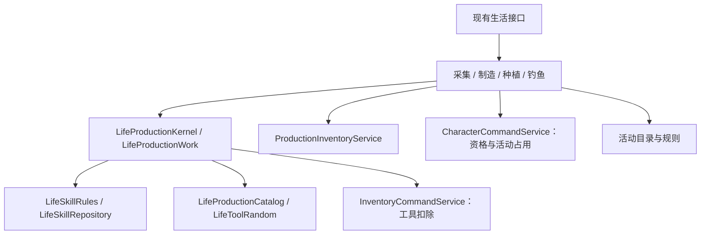

# 生活技能框架

生活系统采用公共内核、活动模块、内容配置三层组织。框架复用专业成长、工具结算和库存规则；采集、制造、种植、钓鱼分别管理自己的操作时序与状态。此改造不修改玩法、数值、HTTP 路径或持久化格式。

## 模块与职责



| 模块 | 负责 | 调用者必须保证 |
| --- | --- | --- |
| `LifeSkillCommandService` | 学习、遗忘、专业名额、首次赠送工具 | 通过现有命令入口调用 |
| `LifeProductionKernel` | 检查专业及最低等级，创建当前命令独立的作业 | 先取得角色锁，账号与角色归属匹配，处于写事务中 |
| `LifeProductionWork` | 工具类型、档位、选定数量；即时升级与半点衰减；成功后工具报废 | 工具来自该角色的当前库存；只在创建作业的持锁事务内使用 |
| `ProductionInventoryService` | 扣料与产物交换、材料绑定传播、净容量检查 | 活动先验证配方及材料用途；必须加入外层事务 |
| `CharacterCommandService` | 战斗及副本资格、生活活动占用、派遣伙伴保护 | 活动按原有规则明确选择资格检查，使用会话编号释放占用 |
| 活动目录 | 内容索引、物品与地图引用、专业类别和数值校验 | 正式配置须通过 schema 与 Java 目录校验 |

`LifeProductionWork` 是一次命令的可变作业，不是数据库会话或 Spring 单例。`open` 要求已有事务；调用者不得将作业放入字段、缓存、HTTP 返回值或持久化状态。采集每个结算心跳和钓鱼捕获结算都重新打开作业，批量制造和批量收获则在同一作业内逐件执行。

## 成功结算协议

现有活动命令仍是事务入口，继续负责参数验证、角色锁、回执或 revision 校验、地点与活动特有资格。回执命中时直接返回，不能重新打开作业或抽取随机结果。

取得作业后，按活动需要使用以下操作：

| 操作 | 调用时机 | 当前使用者 |
| --- | --- | --- |
| `selectTool` | 使用角色库存实例选择工具和本次可用数量，一次作业只能选择一次 | 四类活动 |
| `complete` | 产出成功、扣料及特有消耗完成后，增加熟练度并判定工具报废 | 制造、采集、钓鱼 |
| `wearTool` | 成功操作只消耗工具、不增加熟练度 | 播种 |
| `reward` | 成功产出只增加熟练度、不使用工具 | 收获 |

`complete` 与 `wearTool` 返回本次工具是否报废；`toolsRemaining` 是选定预算的剩余数量。活动负责将它转换成自身的停止原因或会话状态。单次采集结算仅为当前一轮选择一把工具，会话中的备用数量由采集模块维护；批量制造及播种将整个选定预算交给作业。

`reward` 每件按最新熟练度计算并立即写入同一事务，因此批量中途升级会改变后续收益。零奖励不重复写库。种植遗忘重学后收获高等级旧作物的零奖励例外仍由种植模块判断，公共奖励函数继续拒绝未解锁内容。

净容量不足、资源不足和工具耗尽由活动决定暂停或部分完成；失败件不能调用成功结算。随机或持久化异常继续向外抛出，由原有事务回滚库存、熟练度、伙伴资源、活动状态和回执。回滚后丢弃本次作业，新请求重新创建。

## 四类活动保留的职责

| 活动 | 自有实现 |
| --- | --- |
| 采集 | 服务端在线计时、revision、暂停与恢复、伙伴补给和扣费、稀有抽取前容量预检、会话备用工具 |
| 制造 | 配方与设施、材料实例预算、逐件材料分配、工具升档配方例外、部分完成结果 |
| 种植 | 地块与扩建、浇水时间、离线生长、播种绑定、旧作物收获资格 |
| 钓鱼 | 固定步长模拟、输入与断线、鱼饵消耗、捕获状态、结束时释放活动占用 |

不引入统一 `start/tick/finish` 父类、通用状态 JSON 或按名称分发的万能命令。当前机制的变化点不同，共用生产协议已经由四个真实活动使用；新增接口应以实际出现的第二个实现为依据。

## 扩展方式

### 增加同类内容

新增矿点、配方、作物或鱼种时，修改对应 `content/*.json`。新增物品、工具或地图引用时同时补齐相应目录，并运行目录校验和对应活动测试。沿用现有机制无需修改生产内核。

### 增加沿用现有机制的专业

当前专业身份仍使用 `LifeSkillRulesSkill` 枚举：新增专业需声明名称、工具类型及类别，并同步允许的 schema 枚举、初始工具、内容和前端展示。选择采集或制造等现有活动后复用它的操作实现及公共作业。现阶段不宣称新专业完全由 JSON 注册，也不新增运行时插件装载器。

### 增加新机制

例如养殖：新增自己的命令、查询、请求和持久化状态；按照需要复用学习成长、活动占用、生产库存及作业。先明确产出、熟练度和工具实际发生在哪个动作，再选择对应结算操作。只有公共协议确实无法表达已确认行为时才扩展内核。

## 前端接入

前端现在也按同一边界组织，但不抹平活动自身的状态机：

* `features/life/activities.ts` 是活动注册表，集中维护标题、路径、查询键、接口入口、加载提示和页面懒加载器。生活技能首页、路由和准入守卫都从这个注册表生成，新增活动不会再遗漏导航或守卫白名单。
* `features/life/ui/LifeActivityPage.vue` 是公共页面壳，只负责标题、返回入口、活动说明、统一错误与结果提示、加载状态，以及给活动留下介绍插槽和正文插槽。它不持有活动状态，也不解释命令结果。
* 各活动 composable 仍管理自己的查询、命令、revision、缓存失效和前后台生命周期；它们从注册表读取接口前缀和查询键，在各自模块组合具体命令后缀，命令参数与操作顺序保持原样。
* 各活动页面继续拥有自己的交互：实时采集和钓鱼保留 revision 及前后台处理，农田保留批量操作，制造保留材料实例选择。公共壳只收敛重复的页面外壳，不引入统一请求封装或通用状态机。

新增一个生活活动时，先在注册表加入定义和懒加载页面，再让对应 composable 使用该定义，最后把活动测试加入浏览器回归。独有的说明放在 `introduction` 插槽，专业状态和操作区放在默认插槽；不要把活动状态提升到公共壳。

## 验证入口

`LifeProductionKernelTest` 覆盖十种专业共同协议、工具预算、批量升级衰减、播种与收获分离、非法资格不产生副作用。它不替代真实数据库验收。

现有 `LifeCraftingFlowTest`、`GatheringFlowTest`、`GatheringEnduranceTest`、`FarmManagementTest`、`FishingFlowTest`、`LifeActivityTest` 继续覆盖活动流程、库存、占用、回执、异常回滚与跨请求状态；`LifeCooperationTest` 验证跨角色生产交易。按[测试工作流](testing-workflow.md)在同一次 Maven 命令中运行相关测试。

## 新活动接入清单

先区分内容扩充、专业扩充和新增机制：已有页面能表达的新配方或作物只改内容；沿用既有机制的新专业先扩展专业定义；只有出现独立操作时序和状态时才增加活动模块与页面。

### 后端步骤

1. 在 `avalon-content/src/main/resources/content/` 维护内容及 `schemas/` 下对应 schema。现有参考是 `gathering.json`、`life-production.json`、`farming.json`、`fishing.json`。内容目录负责等级、物品、工具、地图等引用校验；新增机制才增加自己的目录和校验测试。
2. 在 `avalon-world` 增加活动查询、命令、请求和结果类型；有跨请求状态时增加持久化实现和数据库迁移。HTTP 路由按现有接口组织，前端注册不会自动创建后端接口。
3. 命令在写事务内先校验请求、锁角色、处理回执或 revision，再判断地点、战斗、副本与活动占用。账号与角色的归属由持锁入口保证；公共内核不重复查询角色。
4. 在需要结算的命令中创建局部 `LifeProductionWork`，工具必须来自本角色当前库存。按成功结算协议选择 `complete`、`wearTool` 或 `reward`；无工具活动不必调用 `selectTool`。保持产出、扣料、成长、活动状态和回执处于同一事务；异常后不再使用旧作业。
5. 为活动补真实数据库用例：成功、资格失败、容量或材料不足、重复请求、跨请求状态及异常回滚。使用占用的活动还要测试释放时机；实时活动还要测试 revision 和离线处理。

### 前端步骤

1. 在 `features/life/activities.ts` 增加一个定义，提供唯一的路径、接口前缀与查询键，以及标题、说明、加载提示、页面懒加载器。不要改已有查询键来追求命名一致，否则会改变已有缓存身份。首页、路由、准入守卫自动消费定义，无需手动补白名单。
2. 在 `features/life` 增加活动自己的 composable，通过定义读取接口和查询键。命令后缀直接在活动内组合，例如 `` `${lifeActivities.fishing.endpoint}/input` ``；不要新增全局命令分发器。跨页面跳转也读取目标活动的 `path`。
3. 新页面采用 `LifeActivityPage`，传入 `activity`、查询的 `pending`、按优先级排列的错误消息数组和可选的结果文字。公共壳展示第一个非空错误。查询状态和请求错误仍由活动拥有；公共壳不发请求、不清空错误、不触发缓存失效。
4. 页面在自己的 setup 中使用 `usePageActive`，保留 Ionic 离页、返回、后台及卸载处理。实时定时器、revision、断线恢复和并发请求控制不得移到公共壳。
5. 框架浏览器用例会自动遍历新增定义，验证入口链接、页面标题、活动说明、真实 GET 和刷新准入。若新活动的读接口需要专门前置条件，在 `LifeSkillsBrowserIT` 中准备独立夹具或调整框架夹具，并补活动自身的操作用例。框架用例通过不等于操作流程通过。

### 可复制的验证命令

从仓库根目录执行；需要 Docker、仓库要求的 Java/Node 工具链及已安装的前端依赖。

```bash
# 前端生产构建与测试类型检查（后者使用 vue-tsc，支持注册表里的 Vue 页面导入）
npm --prefix avalon-ui run build
npm --prefix avalon-ui run test:typecheck

# 内容与生产内核的公共协议
./mvnw -q -pl avalon-app -am -Dskip.frontend=true -Dtest=LifeProductionKernelTest,LifeProductionCatalogTest,FarmingCatalogTest,FishingCatalogTest,LifeItemReferenceTest,LifeResourceMapTest -Dsurefire.failIfNoSpecifiedTests=false test

# 打包刚构建的静态资源，再运行完整生活技能浏览器专项
./mvnw -q -pl avalon-app -am -DskipTests -Dskip.frontend=true package
AVALON_LIFE_BROWSER=1 PLAYWRIGHT_CHROMIUM_EXECUTABLE=/usr/bin/google-chrome ./mvnw -q -pl avalon-app -am -Dskip.frontend=true -Dtest=LifeSkillsBrowserIT -Dsurefire.failIfNoSpecifiedTests=false test
```

Chrome 路径按本机调整；使用 Playwright 自带浏览器时省略 `PLAYWRIGHT_CHROMIUM_EXECUTABLE`。只检查注册接入时，在最后一条 Maven 命令追加 `-Davalon.life.browser.grep=生活活动注册后`；修改命令路径或交互后运行完整专项。核对 `avalon-app/target/life-browser.log` 的实际执行数量和 `surefire-reports`，不能把未设置环境变量产生的跳过当作通过。活动逻辑改动还应按前述测试工作流补相应数据库流程测试。

## 职责边界审查记录

本轮检查了生产内核的四类调用者、五个前端活动、注册表、路由及准入守卫。结论和处理如下：

| 检查点 | 结论与处理 |
| --- | --- |
| 生产内核是否持有活动状态 | 只保存单次命令的成长与工具预算；地块、会话、revision、回执和停止原因继续由活动处理，不新增通用活动父类 |
| 角色归属和库存权限 | 角色锁与库存来源仍是调用者契约；`MANDATORY` 保证已有事务，不声称它能自动验证锁或归属。新增调用者必须按接入步骤验证 |
| 各活动的结算差异 | 保留播种只损耗、收获只成长、制造逐件结算和实时活动每次命令重建作业，不合并时序 |
| 公共页面壳是否掌管请求 | 只展示传入状态，保留介绍与正文两个实际使用的插槽；移除没有使用者的专业信息插槽，专业状态保留在活动正文 |
| 路径与接口重复定义 | 页面间制造跳转统一读取注册表；查询及命令统一读取接口前缀，命令后缀仍在各活动中显式定义 |
| 注册与权限 | 注册表只驱动页面入口与导航准入，不授予专业、地点或生产资格；服务端接口继续独立鉴权 |
| 是否继续抽象请求与缓存 | 当前活动有不同的幂等、心跳和失效策略，保持各自实现；本轮不改变请求时序和缓存失效范围 |

这是当前实现的审查结论。后续改动以真实活动需求扩展公共协议，不预留尚无使用者的接口。
